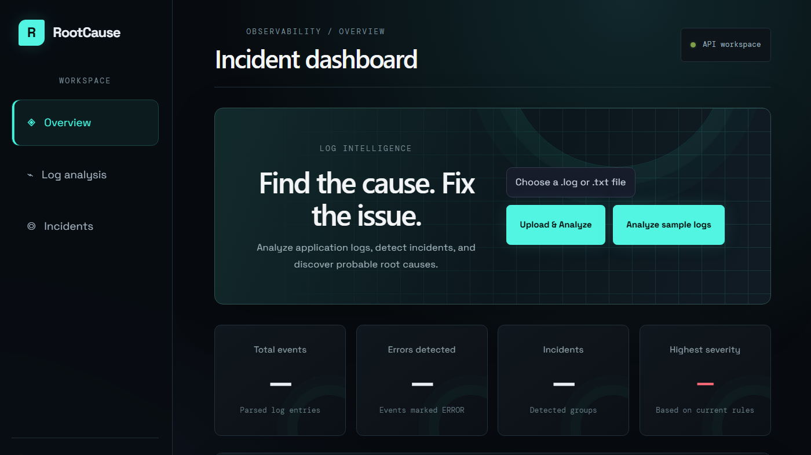
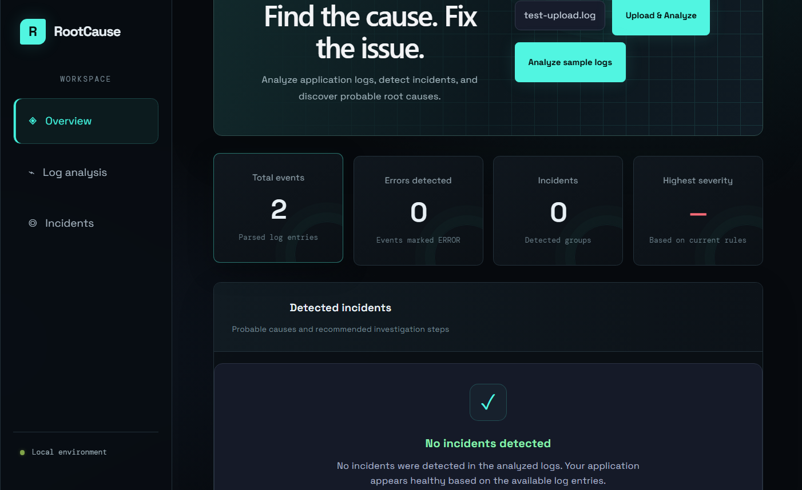
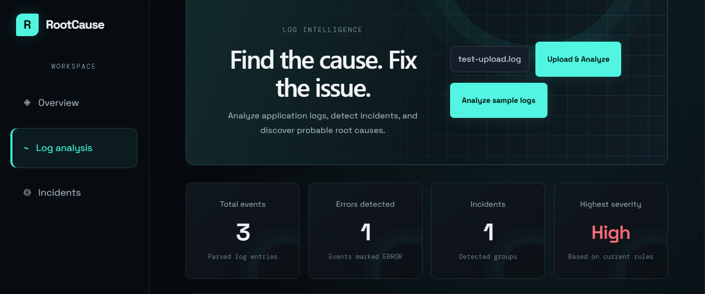
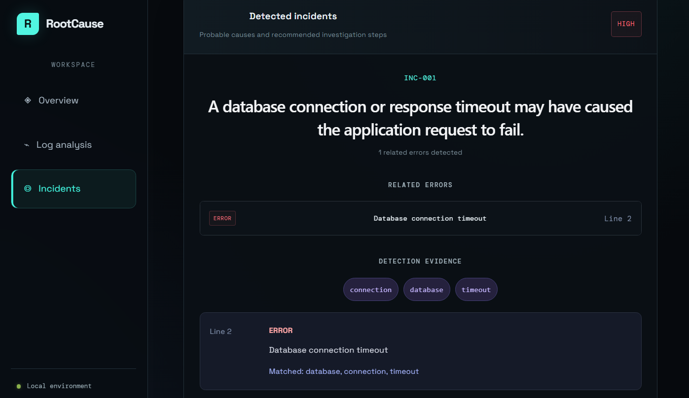
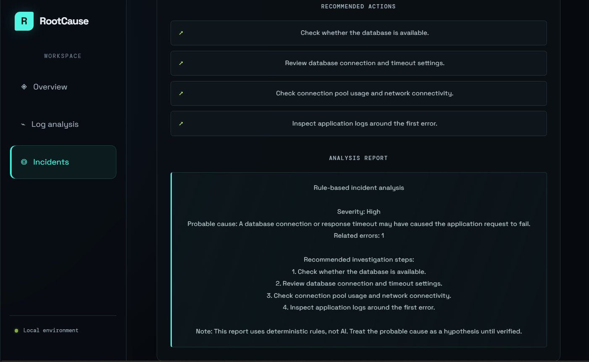

# RootCause — Log Analyzer & Incident Detection

**Turn application logs into actionable incident insights.**

RootCause is a full-stack log analysis application that parses application logs, identifies errors, detects potential incidents, and presents evidence and recommended investigation steps through a web dashboard.

🌐 **Live Demo:** [Open RootCause](https://root-cause-9ghefpoja-jaswanth-projects1.vercel.app/)

🔗 **Backend API:** [RootCause API](https://rootcause-api-xjto.onrender.com/)

📖 **API Documentation:** [Explore the FastAPI Docs](https://rootcause-api-xjto.onrender.com/docs)

## Screenshots

### Dashboard



### Sample Log Analysis



### Uploaded Log Analysis



### Incident Details



### Recommended Actions




## Features

* **Log Parsing:** Processes timestamped application log entries and identifies log levels.
* **Error Detection:** Identifies error events and groups relevant evidence into potential incidents.
* **Incident Analysis:** Provides severity classification, supporting evidence, and recommended investigation steps.
* **Log File Upload:** Upload `.log` and `.txt` files for analysis.
* **Interactive Dashboard:** Displays event counts, errors, incidents, and analysis results.
* **REST API:** Exposes log analysis functionality through FastAPI endpoints.
* **Rule-Based Fallback:** Provides deterministic analysis without requiring a successful AI API response.
* **Optional AI Integration:** Includes Gemini integration code for AI-assisted incident explanations.

## Technology Stack

| Area              | Technologies                                      |
| ----------------- | ------------------------------------------------- |
| Frontend          | React, Vite, CSS                                  |
| Backend           | Python, FastAPI                                   |
| Log Analysis      | Python, rule-based parsing and incident detection |
| AI Integration    | Google Gemini API                                 |
| API Documentation | Swagger UI / OpenAPI                              |
| Version Control   | Git, GitHub                                       |
| Deployment        | Vercel (frontend), Render (backend)               |

## How It Works

1. The user opens the dashboard and analyzes the sample logs or uploads a log file.
2. The frontend sends a request to the FastAPI backend.
3. The backend parses valid log entries and identifies error events.
4. The incident detection logic evaluates the available evidence and identifies potential incidents.
5. The API returns structured results, which the dashboard displays with incident details and recommended actions.

## Architecture

```text
User
 |
 v
React + Vite Dashboard
 |  Hosted on Vercel
 v
FastAPI REST API
 |  Hosted on Render
 v
Log Parser
 |
 v
Error Detection & Incident Analysis
 |
 v
Evidence + Severity + Recommended Actions
 |
 v
Dashboard Results
```

## Run Locally

### Prerequisites

* Python 3.10 or later
* Node.js and npm
* Git

### 1. Clone the repository

```bash
git clone https://github.com/JaswanthT1/RootCause.git
cd RootCause
```

### 2. Set up the backend

From the project root, create a virtual environment:

**Windows PowerShell**

```powershell
python -m venv venv
.\venv\Scripts\Activate.ps1
```

Install the Python dependencies:

```powershell
pip install -r requirements.txt
```

Start the API:

```powershell
uvicorn main:app --reload
```

The backend should be available at:

* API: http://127.0.0.1:8000
* Interactive API documentation: http://127.0.0.1:8000/docs

### 3. Set up the frontend

Open a second terminal:

```powershell
cd frontend
npm install
```

Create a `.env` file inside the `frontend` directory:

```dotenv
VITE_API_BASE_URL=http://127.0.0.1:8000
```

Start the development server:

```powershell
npm run dev
```

Open the local frontend URL printed by Vite, usually http://localhost:5173.

### 4. Optional Gemini configuration

If you want to use the Gemini integration, configure your API key in the backend's local `.env` file:

```dotenv
GEMINI_API_KEY=your_api_key_here
```

Keep your real API key private. Never commit `.env` files or expose API keys in frontend code.

## API Endpoints

| Method | Endpoint          | Purpose                                 |
| ------ | ----------------- | --------------------------------------- |
| `GET`  | `/`               | Check API status                        |
| `GET`  | `/analyze`        | Analyze the sample log file             |
| `POST` | `/analyze-upload` | Upload and analyze a supported log file |

Visit the [interactive API documentation](https://rootcause-api-xjto.onrender.com/docs) to inspect the available endpoints and test requests.

## Example Result

During testing with the included sample log file, RootCause returned:

* **Total events:** 3
* **Error events:** 1
* **Detected incidents:** 1

Results depend on the contents of the analyzed log file.

## Project Structure

```text
RootCause/
├── main.py
├── sample.log
├── requirements.txt
├── .gitignore
└── frontend/
    ├── src/
    │   ├── App.jsx
    │   ├── App.css
    │   └── index.css
    ├── package.json
    └── ...
```

## Current Scope & Limitations

* Incident detection uses defined rules and keywords; it does not prove the actual root cause of a production failure.
* AI-assisted analysis depends on valid Gemini configuration and API availability.
* Results are only as useful as the logs supplied.
* The project is a portfolio demonstration and is not a replacement for a production observability or incident-management platform.

## Future Improvements

* Add more log formats and configurable detection rules.
* Improve incident correlation across multiple services.
* Add automated tests and structured logging.
* Introduce incident history and analytics.
* Expand deployment monitoring and error handling.

## Author

**Jaswanth Kakumanu**

Aspiring software developer focused on Python, backend development, APIs, and practical full-stack projects.

* **GitHub:** [@JaswanthT1](https://github.com/JaswanthT1)
* **Project Repository:** [RootCause](https://github.com/JaswanthT1/RootCause)
* **Live Demo:** [RootCause Web App](https://root-cause-ashy.vercel.app/)

---

*Built as a portfolio project to explore log processing, backend API development, incident detection, and full-stack deployment.*
